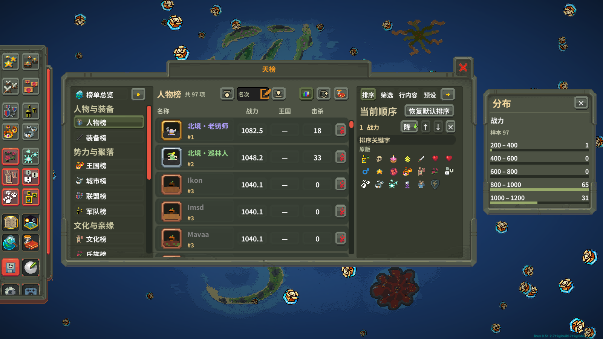
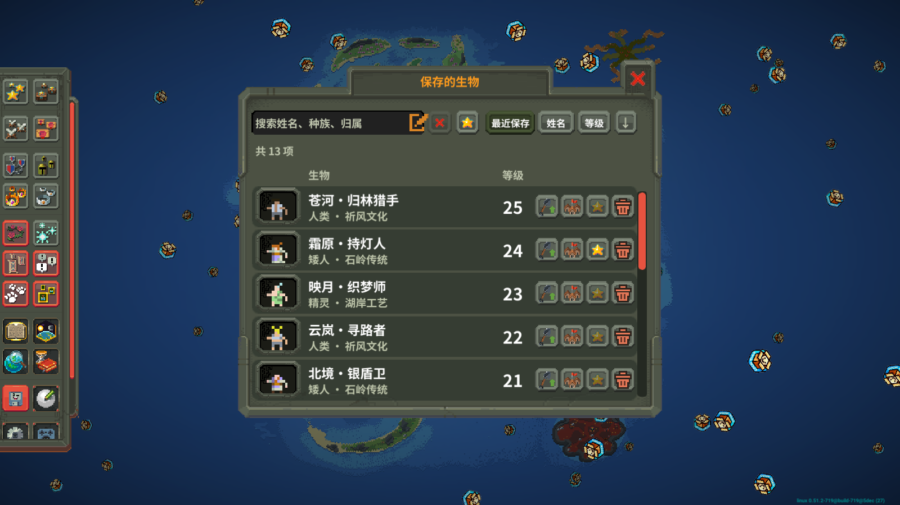
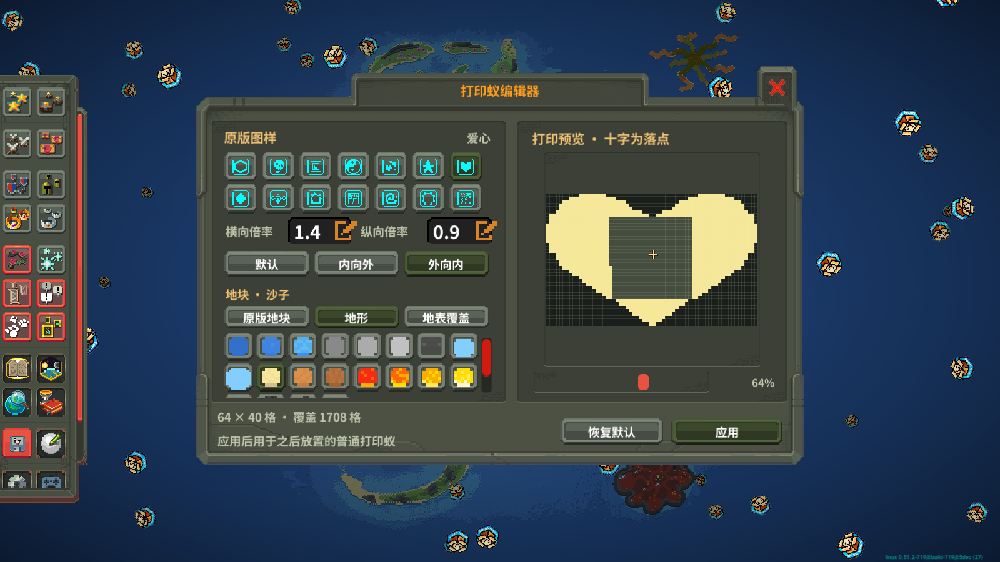

# GodTools

为 WorldBox 添加生物编辑、可自定义的排行榜和世界工具。通过 NeoModLoader 加载后，在游戏底栏打开 GodTools，默认进入「生物」页。

「生物 → 天榜」可以查看人物、装备、王国和文化等榜单，自选排序、筛选和显示字段。常用配置可以收藏到总览，也能保存当前排名供以后对照。[天榜用法](Doc/天榜.md)

在人物详情可以调整称号和背包资源，也能连同特质、装备和背包一起保存角色。到「保存的生物」搜索或收藏，再把角色放回地图，或放入当前世界的村庄。

「世界」页可以按关键词、年份和事件类型查历史，用世界脚本设置自动规则，或预览打印蚁的图样和打印顺序。进行中的打印任务可以在读档后继续。[世界脚本用法](Doc/世界脚本.md)

在模组设置中可以禁止镜头晃动，隐藏光标、掉落物和人物悬停提示，也能调整纪元光线和黑夜遮罩。

## 给接入模组的 Agent

用 `RankingRegistry` 注册榜单、指标和战力所用的技能数据，用 `CreatureSaveExtensions.Register` 保存和恢复角色的模组数据，用 `WorldScriptRegistry.RegisterAction` 和 `RegisterCondition` 扩展世界脚本。在 GodTools 初始化后注册，并给每项定义使用带模组前缀的稳定 ID。[天榜与战力](Doc/模组接入.md#注册天榜) · [角色保存](Doc/模组接入.md#接入角色保存) · [世界脚本](Doc/模组接入.md#扩展世界脚本)
